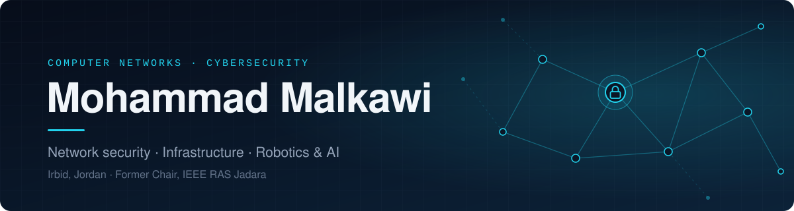
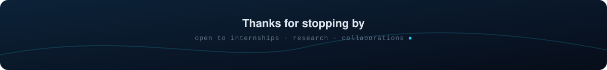

## About me

Hi, I'm **Mohammad** — a third-year Computer Networks & Cybersecurity student at Jadara University in Irbid, Jordan.

I'm interested in how connected systems are built and how they stay safe: how data moves across a network, where that path can be attacked, and how to design infrastructure that holds up. Most of what I build sits where networking meets the physical world, and I lead student engineering programs as Vice Chair of the IEEE Jadara Student Branch.

<table>
  <tr>
    <td width="33%" valign="top">
      <h4>🌐 Networking</h4>
      Designing reliable networks and understanding the protocols that keep systems talking to each other.
    </td>
    <td width="33%" valign="top">
      <h4>🔐 Security</h4>
      Learning how systems are attacked so I can defend them — traffic analysis, hardening, and data you can trust.
    </td>
    <td width="33%" valign="top">
      <h4>🤖 Systems & AI</h4>
      Bringing AI into real systems, from traffic signals to lab rigs and creative tools.
    </td>
  </tr>
</table>

> **Currently open to** networking & cybersecurity internships, remote or in Jordan.

## Featured projects

### 🎬 [After Effects MCP Pro](https://github.com/malkawi06/After-Effects-mcp-pro) — Claude as a motion designer

Most After Effects connectors give an AI a few fixed commands and no way to see what it made. **After Effects MCP Pro** is an open-source MCP server that lets Claude build any scriptable scene in Adobe After Effects, watch its own frames, check timing against the music, fix what fails and render in the background.

| | |
|:--|:--|
| **How it works** | A CEP panel inside After Effects listens only on `127.0.0.1` behind a secret token. The MCP server exposes **14 tools**: inspect, run ExtendScript with a motion library, preview, review with automatic checks and a beat-sync score, render, voice-over, music and fonts. Checkpoints, a read-only switch and per-call logging keep it safe. **53 automated checks**, MIT licensed. |
| **Built with** |     |

### 🌱 [C-Layer](https://malkawi-portfolio.netlify.app/projects/c-layer.html) — Test rig for CO₂-capture materials

Cement makes about 8% of global CO₂, and the materials that capture it wear out in kiln smoke. Plants need to know which one lasts before they invest. **C-Layer** is a bench-top rig that measures each cartridge's capacity under cement-like gas and seals every result in a tamper-evident log.

| | |
|:--|:--|
| **How it works** | 15% CO₂ with ~2% humidity flows through a 2.5 g cartridge until CO₂ breaks through; the curve gives the material's capacity ± error. A six-stage cycle (purge, cool, inlet reading, absorb at 40°C, regenerate at 90–100°C, seal) takes 8–12 minutes per run. Each record is **hash-chained (SHA-256)**, **signed with ECDSA P-256** by a key inside a secure chip, and externally timestamped. |
| **Built with** |      |

### 🚦 [SALKA](https://malkawi-portfolio.netlify.app/projects/salka.html) — Adaptive traffic control for Irbid

Most traffic lights in Jordan run on fixed timers, whatever the actual traffic looks like. **SALKA** rebuilds Culture Circle in Irbid as a digital twin and retimes green phases to the real queues, with priority for emergency vehicles. Result: **up to 15% lower average waiting time**, measured in simulation.

| | |
|:--|:--|
| **How it works** | The road network is pulled from **OpenStreetMap** into **SUMO**. A Python controller reads queues, waiting times and occupancy live through **TraCI** and gives congested approaches longer greens. |
| **Built with** |     |

## Leadership

| Role | Impact |
|:--|:--|
| **Vice Chair** · IEEE Jadara Student Branch | Now. The university's IEEE student branch. |
| **Chair** · IEEE RAS Jadara (2025–2026) | Led the Robotics & Automation Society student chapter and a 7-person team through about 30 workshops and events. |
| **Organizer** · RoboCraft (6 Jan 2026) | A national robotics competition: **110 teams registered**, **~300 participants**, **16 universities**. |
| **Grant** · IEEE RAS | Awarded the **IEEE RAS Chapter Initiative Grant** in 2026 for RoboCraft. |

## Tech stack

  

 

